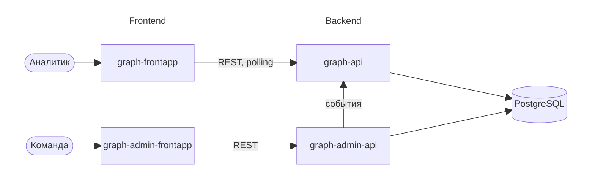

# RFC 01: нулевой RFC

## Контекст и цель проекта

В цифровом банке отдельная операция может выглядеть совершенно обычно, хотя её участники входят в связанную мошенническую сеть. Несколько счетов заходят с одного устройства или IP, переводят деньги одним и тем же получателям, а деньги быстро проходят через цепочку промежуточных счетов. По одной операции такое не поймать, нужно смотреть на связи.

ShuGraph строит граф из клиентов, счетов, устройств и сетевых адресов по потоку операций и событий входа. Граф обновляется по мере поступления событий, система ищет в нём подозрительные группы и считает оценку риска. Аналитику мы показываем подграф связей с признаками, из-за которых оценка выросла. Решение по каждой находке принимает аналитик: подтверждает или отклоняет.

## Цели первого спринта

К концу первого спринта хотим получить (номера фич из [features.md](../../features.md)):

- рабочее место без логина со списком найденных групп: тип и риск (Ф1, Ф2);
- демо-поток: выбираем сценарий, группы появляются в списке вживую, повторный запуск не создаёт дублей (Ф7);
- 5 заготовленных сценариев: 4 со схемами и 1 без мошенничества (Ф8);
- сброс данных одной кнопкой, чтобы повторить демо с нуля (Ф13 в упрощённом виде).

## Не-цели первого спринта

Сознательно откладываем:

- отображение графа и карточку расследования (Ф4, Ф5);
- решения аналитика: подтверждение и отклонение (Ф6);
- фильтры и сортировку списка (Ф3);
- повтор отрезка времени и сверку с разметкой (Ф9, Ф10);
- свой генератор обычного поведения.

## Общая схема системы

Система разделена на две независимые половины: основную (то, чем пользуется аналитик) и админскую (то, через что мы кормим основную данными).

- **graph-api** - ядро системы. Принимает события, отсекает дубли, обновляет граф, ищет подозрительные группы и считает оценку риска. Про генератор ничего не знает: для него это просто один из источников событий.
- **graph-frontapp** - рабочее место аналитика: список найденных групп, карточка расследования, интерактивный граф. Ничего не вычисляет сам, только берёт данные из graph-api и удобно их показывает. Новые находки подтягивает через polling.
- **graph-admin-api** - генератор: проигрывает заготовленные сценарии с известным ответом. Отправляет события в graph-api тем же путём, каким их мог бы прислать любой другой источник.
- **graph-admin-frontapp** - простая админка: выбрать и запустить сценарий, сбросить данные и прочие служебные вещи.
- **PostgreSQL** - основное хранилище. Как именно сервисы делят базу, описано в [backend.md](backend.md).

Почему не один сервис: основная часть не должна зависеть от генератора. Генератор нужен только для разработки и демо, масштабировать его незачем, а у graph-api при необходимости можно поднять несколько реплик. BFF не делаем, для учебного проекта это лишний слой.

Все сервисы живут в одном репозитории: бэкенд в `backend/`, фронтенд в `frontend/`, внутри по папке на сервис.

## Оглавление

- [business.md](business.md) - фичи первого спринта
- [backend.md](backend.md) - стек и архитектура бэкенда, хранение данных
- [frontend.md](frontend.md) - стек и архитектура фронтенда
- [ci.md](ci.md) - сборка и развёртывание на тестовую и продовую площадки
- [team.md](team.md) - командные процессы
- [../../definitions.md](../../definitions.md) - общий словарь проекта
- [../../features.md](../../features.md) - фичи продукта
- [../../schemes.md](../../schemes.md) - мошеннические схемы и правила их обнаружения (SRD)
